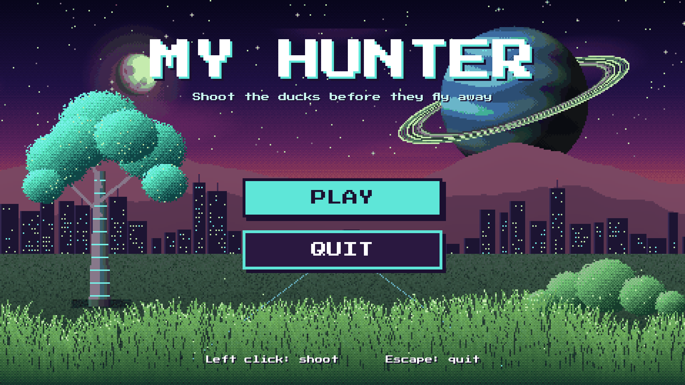
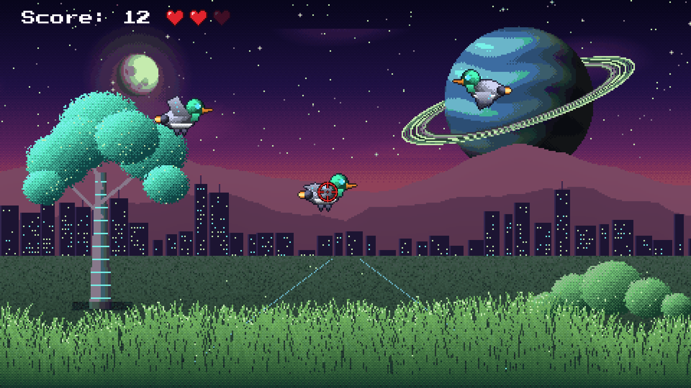
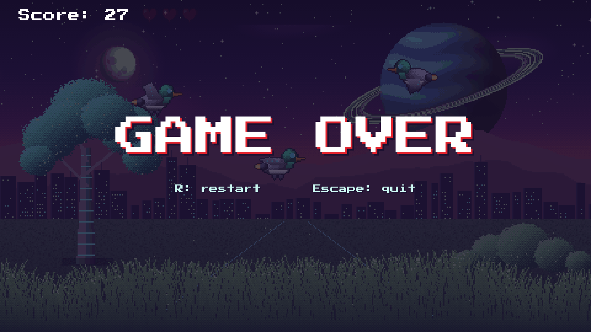
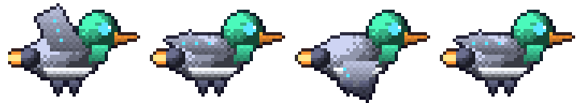

# 🦆 My Hunter

A pixel-art duck shooting game written in **C** with **CSFML**, made for the Epitech `G-MUL-100` module.
Ducks fly across a futuristic night sky: shoot them before they escape!



## Screenshots

| Gameplay | Game over |
|---|---|
|  |  |

## Features

- **Main menu** with clickable *Play* and *Quit* buttons
- **Animated ducks** rendered from a 4-frame sprite sheet, timed with `sfClock`
- **Several ducks at once**, each spawning from a random side, at a random height and speed
- **Progressive difficulty**: ducks get faster as your score grows
- **Lives system**: 3 hearts, one lost for each duck that escapes
- **Game over screen** with instant restart
- **Score** displayed in game
- **Custom crosshair** following the mouse
- **Background music** and a **hit sound effect**
- Frame-rate independent movement and a window limited to 60 FPS



## Controls

| Input | Action |
|---|---|
| Left click | Shoot / press a menu button |
| `R` | Restart after a game over |
| `Escape` | Quit the game |

## Requirements

- `gcc` and `make`
- [CSFML](https://www.sfml-dev.org/download/csfml/) **2.6** (graphics, window, system and audio modules)

## Build and run

```bash
make
./my_hunter
```

Display the usage:

```bash
./my_hunter -h
```

Other rules: `make clean`, `make fclean`, `make re`.

## Project structure

```
.
├── Makefile
├── include/
│   └── my.h            # structures, constants and prototypes
├── lib/my/             # personal C library (my_strcmp, my_revstr, ...)
├── src/
│   ├── main.c          # usage and game loop
│   ├── init.c          # window and global initialisation
│   ├── init_assets.c   # menu, sounds, score, crosshair, hearts
│   ├── init_entities.c # ducks and dog
│   ├── event.c         # keyboard and mouse events
│   ├── update.c        # animation, movement, respawn, score
│   ├── draw.c          # rendering of each screen
│   └── destroy.c       # frees every CSFML resource
├── img/                # sprites, background, menu and game over screens
├── sound/              # music and sound effects
└── font/               # fonts
```

## Credits

- Font: [Press Start 2P](https://fonts.google.com/specimen/Press+Start+2P) by CodeMan38 (SIL Open Font License)
- Background, music and sound effects: [ADD SOURCES HERE]
